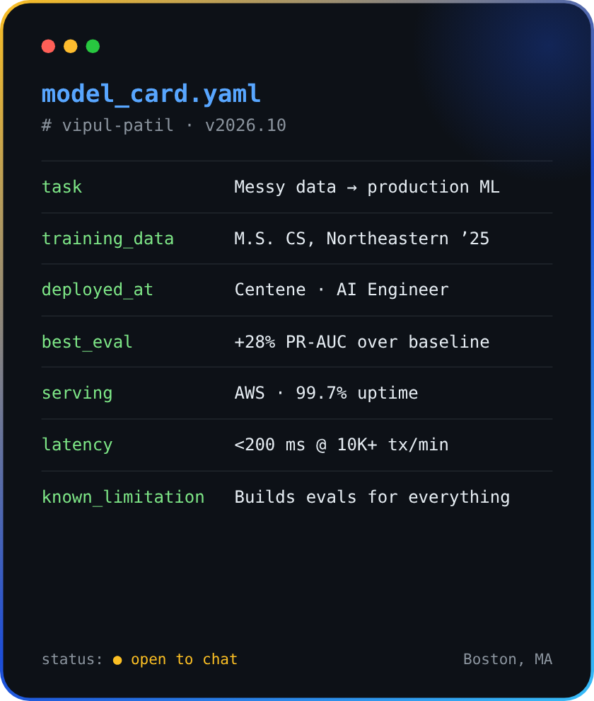

<h1 align="center">Hi 👋, I'm Vipul Patil.</h1>

<h3 align="center">An Applied AI/ML Engineer who ships ML systems that hold up on messy, real-world data</h3>

  

  
  
  
  

- 🏥 I'm currently an **AI Engineer at [Centene](https://www.centene.com/)**, working on fraud detection and retrieval for healthcare claims

- 🔭 I'm currently building **[AI Banking Computer-Use Agent](https://github.com/Vipu-Patil/AI-Banking-Computer-Use-Agent)** and **[IncidentIQ](https://github.com/Vipu-Patil/IncidentIQ)**

- 🌱 I'm currently going deeper on **LLM agents, RAG and ML evaluation**

- 👯 I'm looking to collaborate on **AI agents that are safe enough to use in finance and healthcare**

- 🎓 **M.S. in Computer Science**, Northeastern University (2025)

- 🌐 Everything I've built is on **[my portfolio website](https://vipu-patil.github.io/Vipul-Patil-Portfolio/)**

- 💬 Ask me about **RAG, fraud detection, evals, FastAPI and MLOps**

- 📫 Reach me at **[patil.vipu.2001@gmail.com](mailto:patil.vipu.2001@gmail.com)**

- ⚡ Fun fact: **I will build an eval suite for anything**

 

---

### 📈 Impact

| | Result | Where |
|:-:|---|---|
| 🎯 | **+28% PR-AUC** over baseline on healthcare claims fraud detection | Centene |
| ⏱️ | **40% smaller review queue** for a team of 12 claims adjudicators | Centene |
| 🟢 | **99.7% uptime** on real-time ML scoring endpoints (AWS) | Centene |
| ⚡ | **< 200 ms** risk scoring at **10K+ transactions/min** | Capgemini |
| 🚀 | Release cycle cut from **2 weeks → 3 days** with MLOps pipelines | Capgemini |
| 📝 | **~50% less** analyst documentation time with a LLaMA-based compliance assistant | Capgemini |

---

### 🛠️ Featured projects

<table>
<tr>
<td width="50%" valign="top">

#### 🏦 [AI Banking Computer-Use Agent](https://github.com/Vipu-Patil/AI-Banking-Computer-Use-Agent)
An LLM agent that learns to operate a **legacy banking back-office app** like a human would, then saves the workflow as a **replayable, auditable artifact**.

- Picks only real, verified page elements, so it can't hallucinate clicks
- **Human approval** for risky actions, plus mid-task human handoff
- Tells apart business outcomes, recoverable errors and hard failures
- Redacts PII from logs and evidence

`Python` `Playwright` `Pydantic` `Gemini` `Flask`

</td>
<td width="50%" valign="top">

#### 🚨 [IncidentIQ](https://github.com/Vipu-Patil/IncidentIQ)
An AI **incident-investigation agent** that reads logs, metrics and deployments and writes an **evidence-backed root-cause report**, running on a **local LLM**.

- Curated benchmark of 8 production incidents with a hidden answer key
- Tests against **prompt injection** hidden in logs
- A rollback request must go to a human, not be acted on
- Built in layers: raw LLM → RAG → tools → LangGraph agent

`Python` `FastAPI` `Ollama` `pgvector` `Docker`

</td>
</tr>
<tr>
<td colspan="2" valign="top">

#### 💼 [Portfolio site](https://vipu-patil.github.io/Vipul-Patil-Portfolio/) · [source](https://github.com/Vipu-Patil/Vipul-Patil-Portfolio)
A playful React + Vite portfolio with **"Ask my resume"**, an in-browser TF-IDF retriever that answers visitors' questions from my resume, and an ML-style **model card** about me. `React` `Vite` `JavaScript`

</td>
</tr>
</table>

---

### 🧰 Tech stack

  

| Area | Tools |
|---|---|
| **Machine learning** | XGBoost · feature engineering · PR-AUC evaluation · error analysis · Hugging Face |
| **Retrieval & LLMs** | Embeddings · RAG · FAISS · Pinecone · pgvector · LangGraph · tool calling · prompt engineering |
| **Evaluation & controls** | Offline evals · adversarial testing · LangSmith · human-in-the-loop · auditability |
| **Software** | Python · TypeScript · SQL · C++ · FastAPI · React · REST APIs · PostgreSQL · MongoDB · Apache Spark |
| **Production & MLOps** | AWS · Docker · Kubernetes · GitHub Actions · MLflow · Prometheus |

---

### 💼 Experience

**AI Engineer · Centene Corporation** · *Jun 2025 – Present* · Boston, MA
 Fraud detection and retrieval for healthcare claims: ML models in production with FastAPI on AWS, plus embedding search (FAISS, Pinecone) that gives adjusters historical context in seconds.

**AI Software Engineer · Capgemini** · *Jan 2023 – Aug 2023* · Pune, India
 LLM apps, RAG and real-time risk scoring for financial services: LLaMA-based compliance drafting, RAG over case data (40% faster research), and Python/C++ scoring backends.

**Data Science Intern · PharmaPro** · *Feb 2022 – May 2022* · Mumbai, India
 Python ETL pipelines that turned unstructured PDFs and web data into clean datasets, cutting processing from 2 hours to under 10 minutes.

---

### 🤝 Let's connect

I'm always happy to talk about **LLM agents, RAG, ML evaluation** or **putting AI into production in finance and healthcare**.

<a href="https://vipu-patil.github.io/Vipul-Patil-Portfolio/">Portfolio</a> · <a href="https://linkedin.com/in/vipulpat02">LinkedIn</a> · <a href="mailto:patil.vipu.2001@gmail.com">patil.vipu.2001@gmail.com</a>

